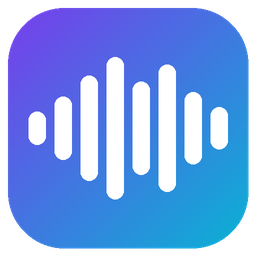

<p align="center"></p>

# VoxShift

**VoxShift is a free, open-source real-time voice changer for Windows and an
alternative to commercial voice changers.** It offers the features you'd
expect from those apps:
* Live voice effects
* AI voice conversion
* A soundboard
* A virtual microphone for Discord, OBS and games
* Hotkeys and a tray icon

Everything runs locally on your PC. There's no account, subscription or
telemetry.

## Download

Get **`VoxShift-Setup-<version>.exe`** from
[Releases](../../releases/latest) and run it.

* **Per-user install.** It goes into `%LOCALAPPDATA%\Programs\VoxShift`, with shortcuts and an uninstaller. The app itself needs no admin rights.
* **Virtual microphone.** Leave **"Install the virtual microphone"** checked. Setup downloads the free [VB-CABLE](https://vb-audio.com/Cable/) driver from vb-audio.com and only runs it if VB-Audio's code signature checks out. Approve the two Windows prompts (admin + driver), once.
* In Discord, OBS or your game, choose **CABLE Output (VB-Audio Virtual Cable)** as the microphone.

> The installer isn't code-signed yet, so Windows SmartScreen may say
> "unrecognized app". Choose **More info → Run anyway**.

## Features

- [x] **20 real-time voices**: robot, demon, deep, chipmunk, male↔female, radio, telephone, megaphone, cave, alien, ghost, auto-tune and more.
- [x] **AI voices from your own recording.** Click **New AI voice**, then pick a clip or record 10 s of someone talking. It uses Seed-VC (Whisper encoder → diffusion transformer → BigVGAN) running locally on ONNX Runtime + DirectML, so it works on any DirectX 12 GPU.
- [x] **Soundboard**: point it at a folder of sounds and they mix into your mic.
- [x] **Virtual microphone** (VB-CABLE), plus **hear myself** monitoring on your headphones.
- [x] **Global hotkeys**: <kbd>Ctrl</kbd>+<kbd>Alt</kbd>+<kbd>F9</kbd> voice changer · <kbd>F10</kbd> hear myself · <kbd>F11</kbd> mute mic · <kbd>F12</kbd> stop sounds. You can change them in Settings.
- [x] **Tray icon**, start with Windows, remembers your devices and last voice.
- [x] **Make your own voices**: every effect is a small JSON file of DSP nodes. See [Custom voices](#custom-voices).
- [x] **100 % offline and private**: no account, no telemetry, no cloud processing.
- [x] **Command line** too: `voxshift-cli convert in.wav out.wav -v demon`.

## How it compares

| | **VoxShift** | Typical commercial voice changer |
|---|:---:|:---:|
| Price | ✅ Free | 💲 Free tier + subscription |
| Open source | ✅ | ❌ |
| Account required | ✅ No | ❌ Usually |
| Works offline | ✅ Fully | ⚠️ Often needs sign-in / online voice library |
| Telemetry / analytics | ✅ None | ⚠️ Common |
| Real-time voice effects | ✅ 20 built in | ✅ Usually hundreds |
| AI voice from your own recording | ✅ Local, unlimited | ⚠️ Often paid or cloud |
| Make / edit your own effects | ✅ JSON voice graphs | ⚠️ Limited |
| Soundboard | ✅ | ✅ |
| Virtual microphone | ✅ via free VB-CABLE | ✅ own driver |
| Hotkeys + tray | ✅ | ✅ |
| macOS | ❌ (Windows app; the CLI runs elsewhere) | ⚠️ Varies |

**Where commercial apps are still ahead:**
* They have much bigger, professionally designed voice libraries.
* Their virtual mic needs no separate driver install.
* AI voice latency is lower. VoxShift's AI voices lag about 1 s on DirectML, while its regular effects stay under 100 ms.
* Their UIs are more polished.

Pull requests welcome.

## Measured (RTX 5070 Laptop, 48 kHz)

| voice | CPU/GPU load (real-time factor) | algorithmic latency |
|---|---|---|
| radio, telephone | 0.002 | 0 ms |
| deep, male↔female, auto-tune | ≈0.02 | 43 ms |
| cave, demon, ghost (convolution reverb) | 0.08–0.12 | 0–43 ms |
| AI voice, ONNX Runtime + DirectML, 6 steps | 0.65–0.79 | ≈1 s end to end |

AI quality was measured as speaker similarity to the target recording
(CAMPPlus embeddings, 0–1):

| clip | similarity |
|---|---|
| your own voice, unconverted | 0.45 |
| VoxShift's AI voice | 0.81 |
| two halves of the same target recording | 0.85 |

## Custom voices

Put a `.json` file in `%APPDATA%\VoxShift\voices\` and it appears in the
voice list:

```json
{
  "name": "Haunted Radio",
  "category": "my voices",
  "chain": [
    {"type": "FormantPitchShifter", "params": {"semitones": -3, "formant_semitones": -2}},
    {"type": "Biquad", "params": {"kind": "bandpass", "freq": 1500, "q": 0.8}},
    {"type": "RingModulation", "params": {"freq": {"lfo": {"rate": 0.5, "min": 20, "max": 60}}, "mix": 0.4}},
    {"type": "ConvolutionReverb", "params": {"decay_s": 2.5, "mix": 0.35}}
  ]
}
```

Available node types:
* **Filters and dynamics:** Gain, Biquad, ParametricEQ, NoiseGate, Compressor, SoftLimiter.
* **Pitch:** PitchShift, FormantPitchShifter (also does auto-tune).
* **Colour:** Vocoder, Whisperize, Distortion, Bitcrusher, RingModulation, Tremolo, Oscillator.
* **Time and space:** Delay, ModDelay, ConvolutionReverb.
* **Routing:** Parallel (latency-aligned branches).

Any numeric parameter can be modulated with `lfo`, `random` or `sequence`.
See `voxshift/dsp/nodes.py` for every parameter.

## Build from source

You need Python 3.12. An NVIDIA GPU is only needed for the PyTorch developer
path.

```bash
git clone --recurse-submodules https://github.com/Metrix187/voxshift.git
cd voxshift
python -m venv .venv
.venv\Scripts\python -m pip install torch torchaudio --index-url https://download.pytorch.org/whl/cu128
.venv\Scripts\python -m pip install -r requirements.txt pyinstaller pystray pillow sv-ttk
.venv\Scripts\python -m voxshift export-onnx      # downloads the open weights, writes models/onnx (~1.2 GB)
.venv\Scripts\python packaging/build.py           # build/dist/VoxShift + installer (needs Inno Setup 6)
.venv\Scripts\python -m pytest                     # 43 tests
```

The developer install can also run the AI voices in PyTorch with a CUDA-graph
solver (`ai-whisper-small`, `ai-realtime`). These have lower latency on
NVIDIA GPUs.

```
voxshift/
  dsp/       streaming STFT, effect nodes, JSON voice graphs + modulators
  ai/        Seed-VC streaming (PyTorch), ONNX export, ONNX Runtime + numpy backend
  audio/     PortAudio engine (mic -> voice -> soundboard -> limiter -> virtual mic + monitor), cable setup
  gui.py     desktop app · cli.py command line · settings/paths/winsys: app plumbing
packaging/   PyInstaller spec, Inno Setup script, build.py, icon
```

## Responsible use

AI voices can imitate real people. Only convert to voices you have permission
to use, and don't use VoxShift to deceive, harass or impersonate anyone.

## License and credits

VoxShift is licensed under **GPL-3.0**. Third-party components and model
licenses are listed in [THIRD_PARTY_NOTICES.md](THIRD_PARTY_NOTICES.md).
* AI voice conversion: [Seed-VC](https://github.com/Plachtaa/seed-vc) (GPL-3.0).
* Vocoder: [BigVGAN](https://github.com/NVIDIA/BigVGAN) (MIT).
* Content encoder: [Whisper](https://huggingface.co/openai/whisper-small) (Apache-2.0).
* Speaker embedding: [CAMPPlus](https://huggingface.co/funasr/campplus) (Apache-2.0).
* Virtual microphone: [VB-CABLE](https://vb-audio.com/Cable/), donationware by VB-Audio, downloaded from their site and not redistributed.
